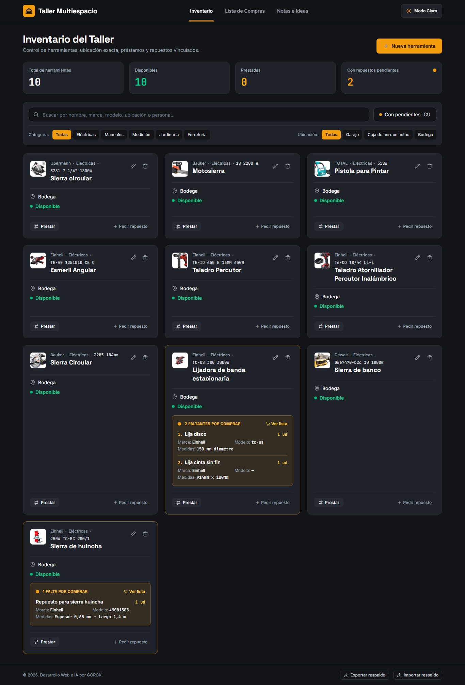

# Taller Multiespacio

Aplicación web progresiva (**PWA**) con estética de **taller industrial** diseñada para gestionar el inventario de herramientas del hogar, coordinar la lista de compras de repuestos y organizar notas técnicas — **100% independiente, instalable en celular y operativa sin conexión a internet**.

[](https://gorck1973.github.io/Taller-Multiespacio/)


---

## Vista previa

<p align="center">
  
</p>

---

## Funcionalidades principales

### 1. Inventario del Taller
- **Panel de resumen en tiempo real**: conteo inmediato de *Total de herramientas*, *Disponibles*, *Prestadas* y *Con repuestos pendientes*.
- **Buscador y filtros rápidos**: filtrado en vivo por nombre, marca, modelo, ubicación o persona; filtros por categoría (`Eléctricas`, `Manuales`, `Medición`, `Jardinería`, `Ferretería`), ubicación (`Garaje`, `Caja de herramientas`, `Bodega`) y acceso directo **`Con pendientes`**.
- **Control de préstamos**: marca herramientas como prestadas registrando a quién se entregaron y en qué fecha, con devolución en un clic.
- **Íconos minimalistas + miniaturas reales con Zoom**:
  - 9 íconos vectoriales industriales con asignación automática y selector manual: *Esmeril, Sierra, Lijadora, Taladro, Llaves, Medición, Pintura, Ferretería y Caja de herramientas*.
  - Carga opcional de imágenes desde galería/archivos o captura directa con cámara, con **compresión automática en el navegador** (~15–35 KB) y visor rápido al tocar la miniatura.
- **Conexión inteligente con repuestos**: cada herramienta con faltantes vinculados muestra automáticamente un bloque de alerta ámbar con indicador pulsante y el detalle completo (`Nombre`, `Cantidad`, `Marca`, `Modelo` y `Medidas`).

### 2. Lista de Compras (Repuestos, Accesorios y Materiales)
- Lista unificada con casillas de verificación, destello visual verde al confirmar la compra y filtros por etiqueta de color (`Repuesto`, `Accesorio`, `Material`).
- **Vinculación con el Inventario**: al asociar un ítem a una herramienta existente se autocompletan su **Marca** y **Modelo** (editables) y se destacan los campos técnicos infaltables (**Marca**, **Modelo** y **Medidas**).
- **Sincronización instantánea**: al marcar un repuesto como comprado, la alerta en la tarjeta correspondiente del Inventario desaparece automáticamente.

### 3. Notas e Ideas
- Tablero visual de apuntes rápidos para guardar medidas de arreglos, códigos de pintura o proyectos pendientes.
- Permite crear, editar, buscar, cambiar el tono visual de la tarjeta y **fijar notas importantes arriba**.

### 4. Experiencia Industrial, Offline y Respaldos
- **Modo Oscuro y Modo Claro**: interfaz en gris carbón (`#121417`) y pizarra (`#1E2229`) con acentos ámbar industrial (`#F59E0B`), más un Modo Claro de alto contraste pensado para consultar en la ferretería.
- **Tipografías técnicas**: `Space Grotesk` para encabezados, `Inter` para lectura general y `JetBrains Mono` para códigos de modelo, cantidades y medidas.
- **App instalable (PWA) y sin conexión**: funciona sin señal gracias a su Service Worker y caché local, con botón de instalación integrado para Android, iOS y escritorio.
- **Respaldo portátil (`.json`)**: guarda todo automáticamente en `localStorage` e incluye botones de **Exportar respaldo** e **Importar respaldo** en el pie de página para mover tu taller entre PC y teléfono sin depender de servidores externos.

---

## Instalación en el teléfono (PWA)

Abre el enlace en vivo: **[gorck1973.github.io/Taller-Multiespacio](https://gorck1973.github.io/Taller-Multiespacio/)**

- **Android (Chrome)**: toca el botón **Instalar App** en la barra superior (o menú `⋮` → *Instalar aplicación*).
- **iPhone / iPad (Safari)**: toca **Compartir** → **Agregar a inicio**.

---

## Tecnologías utilizadas

- **React 19** + **TypeScript**
- **Vite 8** + **vite-plugin-pwa** (Workbox)
- **Tailwind CSS v4**
- **Motion** (transiciones suaves entre pestañas)
- **Lucide React** + iconografía vectorial industrial personalizada

---

## Desarrollo local

Requiere [Node.js](https://nodejs.org) 18 o superior:

```bash
# Clonar el repositorio
git clone https://github.com/gorck1973/Taller-Multiespacio.git
cd Taller-Multiespacio

# Instalar dependencias
npm install

# Iniciar servidor de desarrollo (puerto 3000)
npm run dev
```

Otros comandos disponibles:

```bash
# Compilar para producción (incluye Service Worker PWA)
npm run build

# Verificar tipos TypeScript
npm run lint

# Previsualizar build de producción
npm run preview
```

---

## Despliegue automático

El repositorio incluye el flujo de **GitHub Actions** en `.github/workflows/deploy.yml`, que compila y publica automáticamente cada cambio enviado a la rama `main` en **GitHub Pages** (*Settings → Pages → Source: GitHub Actions*).

---

<p align="center">
  © 2026. Desarrollo Web e IA por <strong>GORCK</strong>.
</p>
